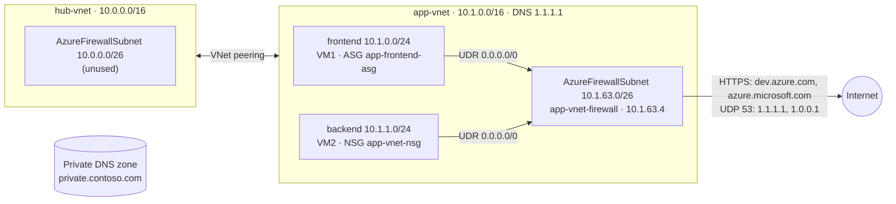

# Azure Secure Network Lab

Secure network setup built hands-on in the Azure portal: two peered VNets, subnet segmentation, an NSG with an application security group, Azure Firewall with a firewall policy, forced outbound routing through the firewall, and a private DNS zone.

> Based on the Microsoft Learn guided project [Configure secure access to workloads with Azure virtual networking services](https://learn.microsoft.com/en-us/training/modules/guided-project-configure-secure-access-workloads/). I built everything in the portal and exported the templates afterwards.

## Architecture

## What I built

| Component | Configuration |
|---|---|
| VNets | `hub-vnet` 10.0.0.0/16 and `app-vnet` 10.1.0.0/16, peered in both directions |
| Subnets | `frontend` 10.1.0.0/24, `backend` 10.1.1.0/24, `AzureFirewallSubnet` 10.1.63.0/26 |
| NSG | `app-vnet-nsg` on `backend`: allow inbound SSH (22) to the ASG `app-frontend-asg` |
| ASG | `app-frontend-asg`, assigned to VM1's network interface |
| Azure Firewall | Standard tier, policy `fw-policy`, private IP 10.1.63.4 |
| Firewall rules | Application rule: HTTPS to `dev.azure.com` and `azure.microsoft.com` from 10.1.0.0/23. Network rule: DNS (UDP 53) to 1.1.1.1 / 1.0.0.1 |
| Route table | `app-vnet-firewall-rt` on `frontend` and `backend`: 0.0.0.0/0 → 10.1.63.4 (virtual appliance) |
| DNS | Custom DNS servers 1.1.1.1 / 1.0.0.1 on `app-vnet`, private DNS zone `private.contoso.com` |
| VMs | VM1 (frontend) and VM2 (backend), Ubuntu, Standard_D2s_v4 |

## How I tested it

| Test | How | Result |
|---|---|---|
| Outbound traffic goes through the firewall | Network Watcher → Next hop from VM1 | <!-- e.g. VirtualAppliance 10.1.63.4 --> |
| Allowed site is reachable | VM1 → Run command: `curl -I https://dev.azure.com` | <!-- result --> |
| Other sites are blocked | VM1 → Run command: `curl -I https://www.google.com` | <!-- result --> |
| DNS works through the firewall | VM1 → Run command: `nslookup dev.azure.com` | <!-- result --> |

Screenshots of each step are in [`docs/screenshots`](docs/screenshots).

## Lessons learned

- **Firewall placement.** In this lab the firewall sits in the app VNet, and the hub stays empty. In a real hub-and-spoke design, the firewall lives in the hub and every spoke routes to it through the peering.
- **Custom DNS vs. private DNS zones.** `app-vnet` uses 1.1.1.1 as its DNS server. VMs then can't resolve Azure private DNS zones, because only Azure's own resolver (168.63.129.16) answers for them. To use both, keep Azure DNS or add a DNS Private Resolver / forwarder.
- **SSH from anywhere.** The NSG allows port 22 from any source. That's acceptable for a short lab. In production, restrict the source, use Azure Bastion and remove public IPs from VMs.
- **Lab image.** Ubuntu 18.04 is out of standard support. Use 22.04 or 24.04 for anything real.
- <!-- Add your own: what confused you, what broke, what you'd do differently -->

## Cost and cleanup

Azure Firewall Standard costs about $1.25 per hour while it's deployed (roughly $900 per month), plus two VMs and three public IPs. I deleted the resource group right after testing.

## Repository contents

| Path | Content |
|---|---|
| `docs/topology.png`, `docs/topology.svg` | Topology export from Azure Network Watcher |
| `docs/screenshots/` | Configuration and test screenshots |
| `export/template.json`, `export/main.bicep` | ARM template exported from the portal and decompiled to Bicep. This is a snapshot for reference and isn't deployable as-is (no admin credentials, hardcoded disk names). |

## Next step

Rebuild the setup in Terraform, with the firewall in the hub.
